<div align="center">

  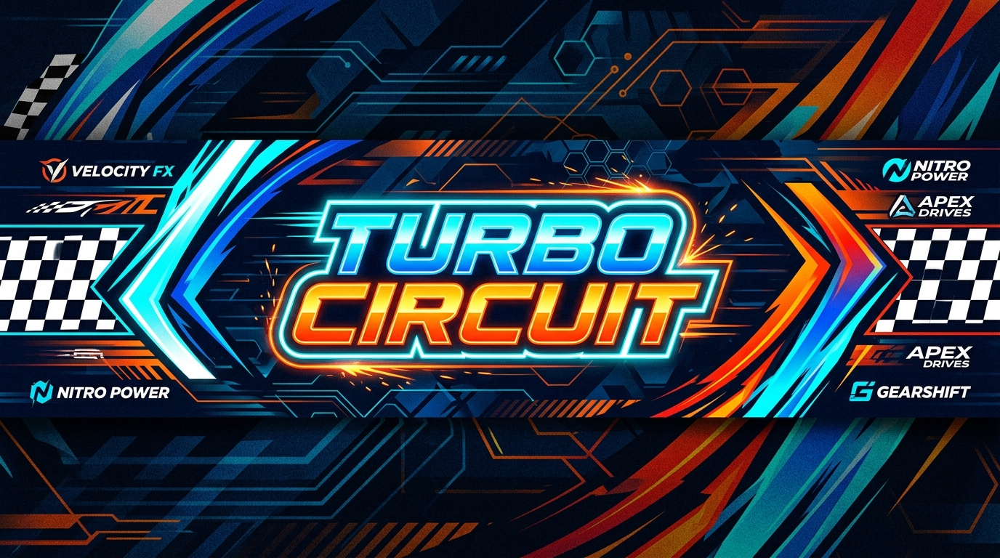

  <br/><br/>

  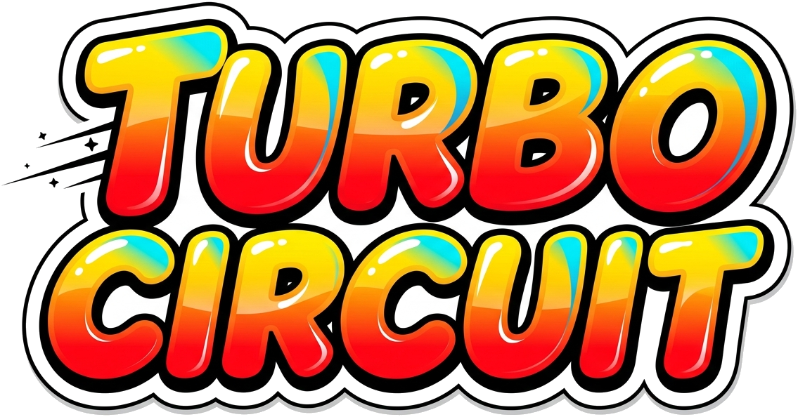

  <h3>🏎️ ドリフトを極め、アイテムで逆転せよ！爽快3Dポップ・カートレーシング 🏁</h3>

  <p>
    <b>1人プレイ・画面分割2P対戦・最大8人オンラインマルチプレイ完全対応！</b>
  </p>

  <p>
    
    
    
    
    
  </p>

</div>

---

## 🎮 ゲーム概要 (About)

**『Turbo Circuit（ターボ・サーキット）』** は、明るくポップなトイ・アーケード調の世界観で繰り広げられる本格3Dカートレーシングゲームです！

直感的で軽快な操作性をベースに、コーナーを華麗に滑り抜ける**ドリフトブースト**、息をのむ**ビッグジャンプ台**、そして一発逆転を狙える**アイテムバトル**を搭載。
白熱のフルグリッドレースが楽しめる**1人プレイ（グランプリ＆タイムアタック）**はもちろん、1台のPCで友達や家族と盛り上がれる**ローカル2P画面分割対戦**、さらには面倒なルーター設定なしで世界中のライバルと繋がれる**最大8人オンラインマルチプレイ（Unity Relay ルームコード対応）**まで、充実のゲームモードを収録しています！

<div align="center">
  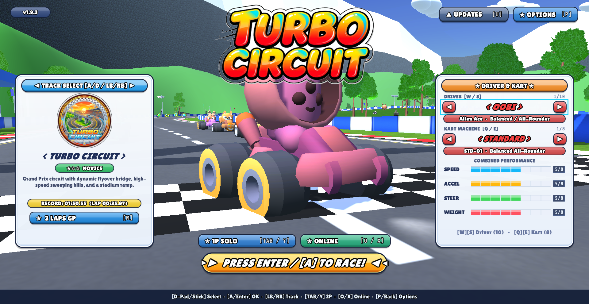
</div>

---

## ✨ 主な特徴 (Features)

- 🏎️ **爽快なアーケード物理＆ドリフトアクション**
  - ボタン1つでホップ＆ドリフト！タイヤの火花が青からオレンジに変わる瞬間に開放して強烈な「ミニターボ」を発動！
  - 各所に設置されたジャンプ台でのトリックや、スタートカウントダウンに合わせたロケットスタートなど、走りを突き詰めるテクニックが満載。

- 🗺️ **ギミック満載の6つの本格サーキット**
  - 緩やかな丘陵と高架橋立体交差が爽快な王道サーキットから、超巨大砂丘のジェットコースター、標高差35mの白銀雪山、サイバーなビル貫通トンネル、実在の道路網を再現した「北海道大学 札幌キャンパス」、そしてダイナミックな高低差15mの8の字立体交差と斜張橋が聳える**「スカイライン・オーバーパス」**まで！

- 👾 **10人のドライバー × 8種のカートマシンによる自由な組み合わせ（全80通り！）**
  - キャラクター（ドライバー10名）とカート（マシン8種）を別々に選択可能！ドライバーとマシンの性能が合算され、最高速重視・加速ドリフト重視・超旋回型・重戦車型など自分だけのセッティングで出走できます。

- 💥 **戦況を一変させる5種類のアイテム**
  - ライバルを足止めする「バナナ」、前方カートを自動追跡する「ホーミングミサイル」、攻撃を防ぐ「シールド」、超高速ダッシュを決める「ターボ」、そして広範囲のライバルを一網打尽にする「ボム」！

- 👥 **いつでも・誰とでも遊べるマルチプレイ環境**
  - **1人プレイ**: 8台フルグリッドの白熱グランプリ ＆ 歴代ゴーストカーと競うタイムアタック
  - **画面分割2P対戦**: 1台のキーボードまたはゲームパッドを使ってその場ですぐに対戦！
  - **最大8人オンライン対戦**: Unity Relay によるルームコード共有で、ポート開放なしで誰でもワンクリック接続。空き枠はCPUが参戦！
  - **柔軟なキーコンフィグ**: キーボードおよび各種ゲームパッドに対応し、ゲーム内設定でいつでもキーバインドを変更可能。

---

## 📸 スクリーンショット (Screenshots)

<div align="center">

| 白熱の8台グランプリレース | 画面分割 2Pローカル対戦 |
|:---:|:---:|
| 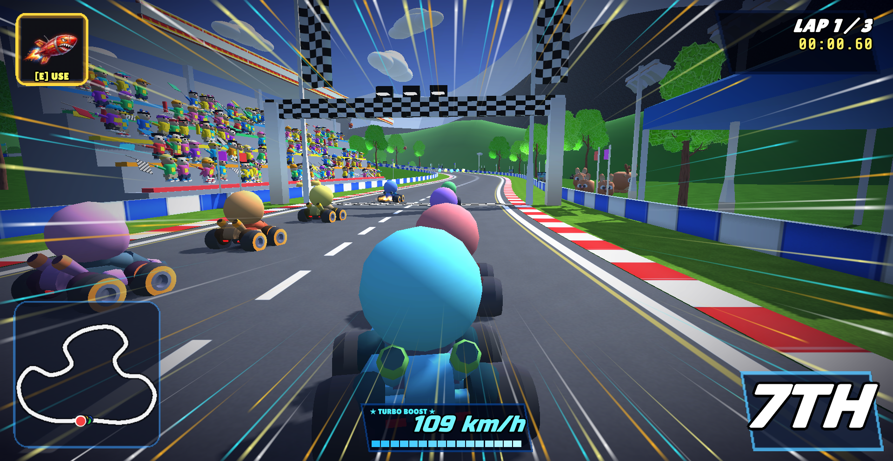 | 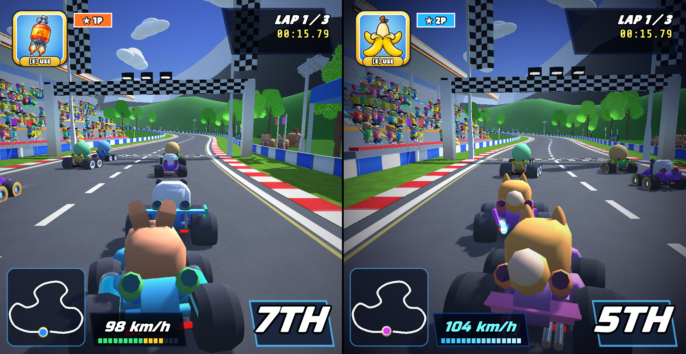 |

| 最大8人 オンラインロビー | 激戦のアイテムバトル |
|:---:|:---:|
| 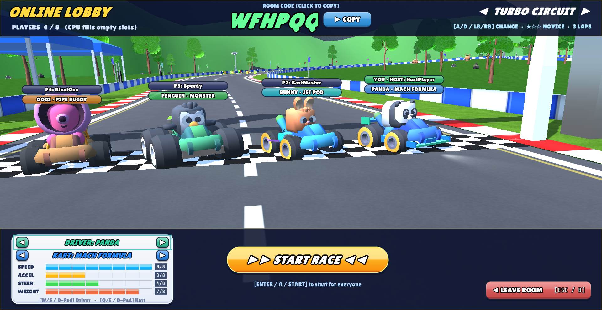 | 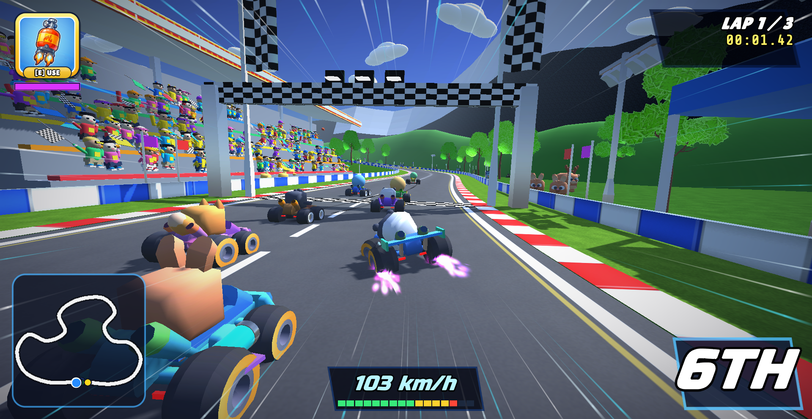 |

| レース結果・リザルト表 | キーボード＆パッドコンフィグ画面 |
|:---:|:---:|
| 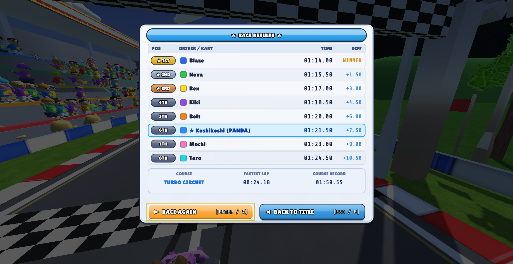 | 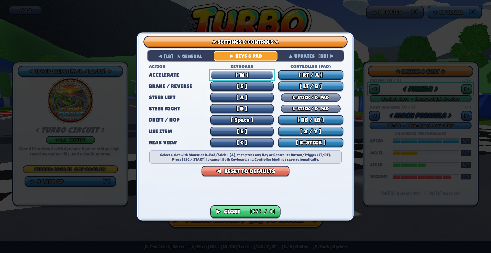 |

</div>

---

## 🏁 コース紹介 (Courses)

全6コース。各コースごとに独自の地形、高低差、ギミック、BGM、そして風景が広がっています。

<div align="center">

### 1. TURBO CIRCUIT (ターボ・サーキット)
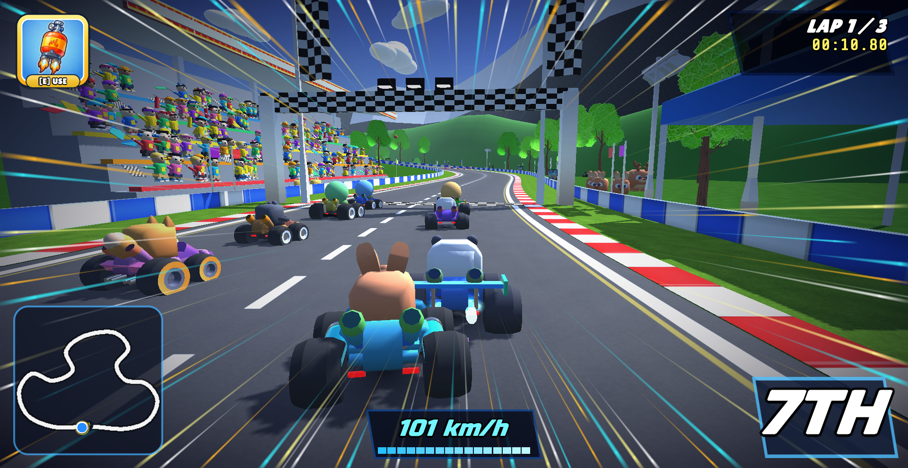

> **難易度**: ★☆☆ (NOVICE)  
> **特徴**: 緑豊かな丘陵地帯を疾走する王道グランプリコース。ダイナミックな高架橋の立体交差、高速S字コーナー、そして終盤のスタジアム・ビッグジャンプ台がレーサーを待ち受けます。

---

### 2. SUNSET DUNES (サンセット・デューンズ)
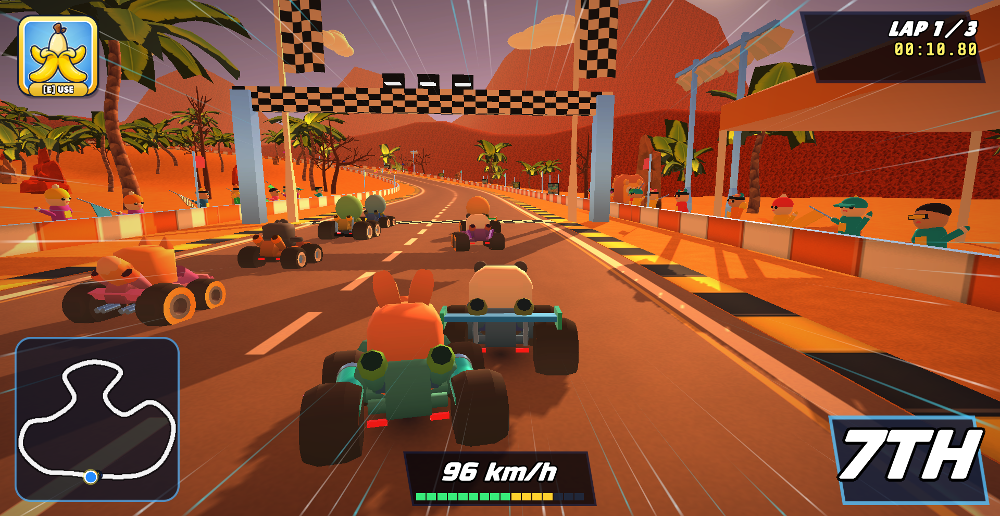

> **難易度**: ★★☆ (INTERMEDIATE)  
> **特徴**: 沈みゆく夕日と赤岩キャニオンが美しい砂漠コース。巨大砂丘を一気に駆け上がった後の超急降下ジェットコースターや、古代ピラミッド遺跡とオアシスを抜けるスリリングなコース設計！

---

### 3. FROST PEAK (フロスト・ピーク)
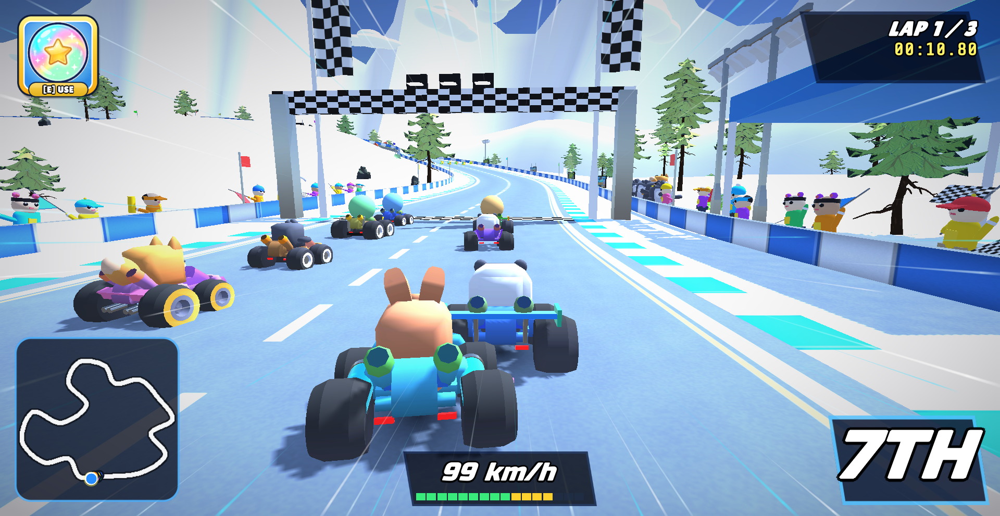

> **難易度**: ★★★ (EXPERT)  
> **特徴**: 標高差35mを誇る過酷なアルペン雪山クライム！雪煙舞う連続ヘアピン、氷河スロープ、そして断崖絶壁のクレバスを飛び越える決死のロングジャンプが待ち受ける超難関コース。

---

### 4. NEON METROPOLIS (ネオン・メトロポリス)
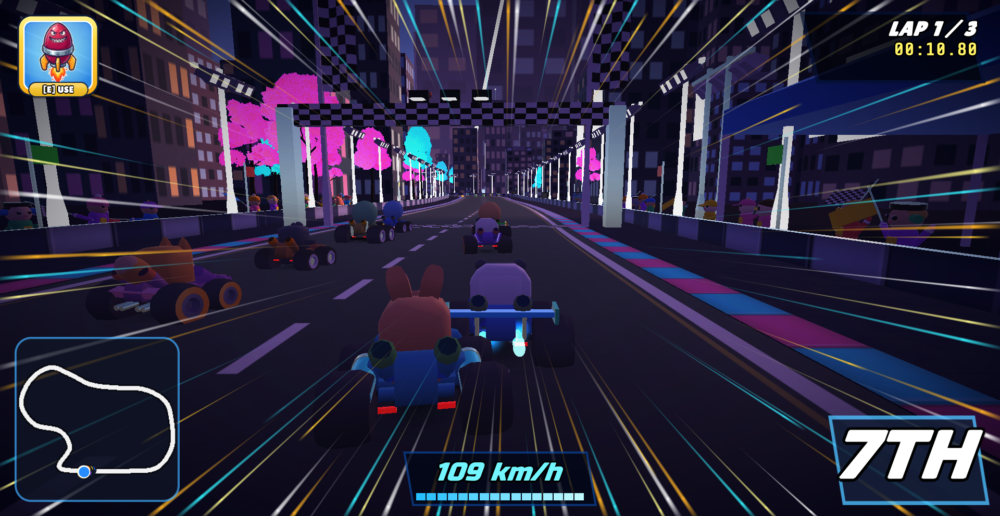

> **難易度**: ★★☆ (INTERMEDIATE)  
> **特徴**: ネオンきらめくサイバー未来都市の黄昏を駆け抜けるナイトレース。超高層ビルの谷間、高速高架ハイウェイ、そして摩天楼のビル群をそのまま貫通する近未来トンネルをフルスロットルで疾走！

---

### 5. HOKKAIDO CAMPUS (北海道大学 札幌キャンパス)
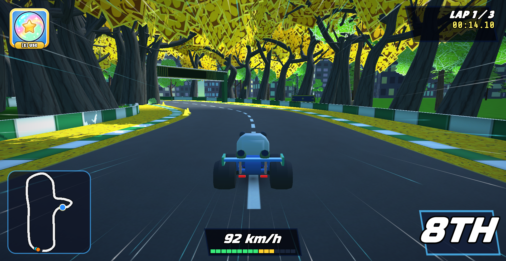

> **難易度**: ★★☆ (INTERMEDIATE)  
> **特徴**: 北海道大学札幌キャンパスの実在する道路・ランドマークを精密に再現！南端の正門・メインストリートから、エルムの森、クラーク像、黄金に輝く「北13条イチョウ並木」、歴史的建造物「第2農場モデルバーン」での大ジャンプ、そして西側の美しいポプラ並木通りを駆け抜けるスペシャルツアーコース！

---

### 6. SKYLINE OVERPASS (スカイライン・オーバーパス)
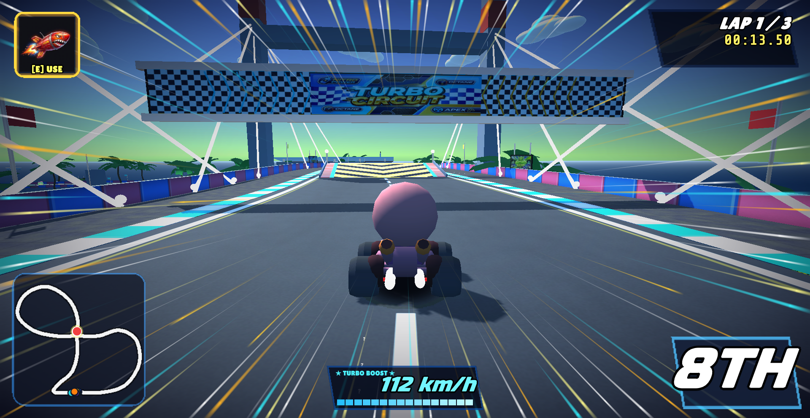

> **難易度**: ★★★ (EXPERT / OVERPASS)  
> **特徴**: 碧く輝く海岸ベイエリアに架かる巨大な8の字型ハイウェイコース！下層（標高0m）の直進アンダーパスと、上空15mを直角に横断する巨大斜張橋（Cable-Stayed Bridge）が完璧な立体交差を形成。スパイラルスロープの登攀、橋梁中央のジャンプ台、そして頭上を交差するライバルたちの姿が見えるエキサイティングなステージ！

</div>

---

## 🏎️ ドライバー＆カート紹介 (Characters & Karts)

**10人の個性派ドライバー**と**8種類のカスタムカートマシン**を自由に組み合わせて出走可能！ドライバーとカートのステータスが合算され、走りの特性が変化します。

### 👤 ドライバー一覧 (10 Characters)

| ドライバー名 | 二つ名 | 特徴・タイプ | スピード | 加速 | 旋回 | 重さ |
|:---:|:---:|:---|:---:|:---:|:---:|:---:|
| **OOBI** | Alien Ace | **ALL-ROUNDER** — 全性能が均等で扱いやすい万能レーサー | 5/8 | 5/8 | 5/8 | 5/8 |
| **OODI** | Pink Dash | **ACCEL & DRIFT** — 立ち上がり加速とミニターボに優れる | 4/8 | 7/8 | 6/8 | 3/8 |
| **OOLI** | Aero Sonic | **TOP SPEED** — 長いストレートで伸びる高速型レーサー | 8/8 | 4/8 | 4/8 | 6/8 |
| **OOPI** | Racer Swift | **SHARP HANDLING** — 急カーブでも鋭くインを突ける旋回型 | 4/8 | 6/8 | 8/8 | 3/8 |
| **OOZI** | Cool Titan | **HEAVY & GRIP** — 当たり負けしない重量級タフガイ | 6/8 | 3/8 | 4/8 | 8/8 |
| **PANDA** | Bamboo Boss | **HEAVY CRUISER** — 安定感抜群のヘビー級パンダレーサー | 6/8 | 4/8 | 5/8 | 7/8 |
| **PENGUIN** | Ice Slider | **ICE DRIFTER** — 素早い加速と滑らかなドリフトが得意 | 4/8 | 8/8 | 7/8 | 2/8 |
| **FOX** | Canyon Dash | **SPEED TRICKSTER** — 最高速とコーナリングを両立したテクニシャン | 7/8 | 6/8 | 6/8 | 4/8 |
| **BUNNY** | Hop Star | **FEATHER LIGHT** — トップクラスの加速と軽快な旋回性能 | 3/8 | 8/8 | 8/8 | 2/8 |
| **LION** | Golden King | **POWER KING** — 圧倒的トップスピードと重量を誇る百獣の王 | 8/8 | 5/8 | 4/8 | 7/8 |

### 🏎️ カートマシン一覧 (8 Kart Machines)

| マシン名 | ボディタイプ | 特徴・カスタム造形 | スピード | 加速 | 旋回 | 重さ |
|:---:|:---:|:---|:---:|:---:|:---:|:---:|
| **STANDARD** | GP Kart | **BALANCED** — デュアルエキゾースト＆リアウイング搭載の王道レーシングカート | 5/8 | 5/8 | 5/8 | 5/8 |
| **PIPE BUGGY** | Light Frame | **QUICK ACCEL** — ロールケージ＆ルーフライトを備えた軽量パイプフレームバギー | 4/8 | 8/8 | 7/8 | 2/8 |
| **MACH FORMULA** | Open Wheel | **MAX SPEED** — ロングノーズ＆大型前後ウイングを備えた超高速フォーミュラマシン | 8/8 | 4/8 | 5/8 | 4/8 |
| **MONSTER** | Big Foot | **HEAVY POWER** — 超大径ワイドタイヤ＆ブルバーを備えた重戦車モンスタートラック | 6/8 | 3/8 | 3/8 | 8/8 |
| **CYBER GT** | Neon Aero | **DRIFT SPEC** — ネオンアンダーグロー＆スプリットウイング搭載のサイバーマシン | 7/8 | 6/8 | 6/8 | 5/8 |
| **ROADSTER** | Classic | **SMOOTH TURN** — クラシックグリル＆ホワイトリボンタイヤの軽快オープンカー | 4/8 | 6/8 | 8/8 | 3/8 |
| **MUSCLE V8** | Supercharger | **RAW TORQUE** — V8スーパーチャージャー＆サイドマフラー搭載のハイパワーマッスル | 8/8 | 5/8 | 3/8 | 7/8 |
| **JET POD** | Twin Turbine | **TURBO BOOST** — 左右ツインジェットタービン＆キャノピー搭載の近未来ポッド | 7/8 | 7/8 | 5/8 | 4/8 |

---

## 🎁 アイテム一覧 (Items)

コース上に点在するレインボーの「？アイテムボックス」を通過するとランダムでアイテムを獲得！`[E]` / `[Ctrl]` キー（パッド: `[X]` / `[Y]` ボタン）で使用できます。

| アイコン | アイテム名 | 効果・使い方 |
|:---:|:---:|:---|
|  | **バナナ (Banana)** | 後方にトラップとして投下。後続車が踏むとスピンして大きく減速します。自分の後方を走るライバルの走行ラインに仕掛けよう！ |
| 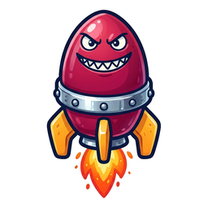 | **ホーミングミサイル (Missile)** | 前方を走るライバルカートを自動追尾して発射！直撃すると大爆発を起こし、相手をクラッシュさせます。前方の逆転に最適！ |
|  | **シールド (Shield)** | カートの周囲に防御バリアを展開。敵のミサイル攻撃やバナナの罠から1回だけ身を守ることができます。トップ独走時の守りの要！ |
| 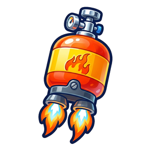 | **ターボ (Turbo / Nitro)** | 強烈なニトロパワーを噴射して瞬間急加速！直線での追い抜きや、芝生・ダートなどのオフロードを強引にショートカットする時に有効！ |
|  | **ボム (Bomb)** | 前方に放物線投擲（下キー/ブレーキ入力で使用すると後方投下）。バウンド後、数秒またはカート接触で大爆発！爆風範囲内のカートを一気に吹き飛ばしてスピンさせます。混戦や集団の打破に絶大な威力を発揮！ |

---

## ⌨️ 操作方法 (Controls)

キーボードおよび家庭用ゲームパッド（Xbox / DualShock / 各種DirectInputコントローラー等）に完全対応しています。

### メニュー操作（キーボード ＆ ゲームパッド対応）
- **項目移動 / 値変更**: `十字キー (D-Pad)` / `左スティック`
- **決定 / レーススタート**: `Enter` / `Space` （パッド: `Aボタン` / `START`）
- **キャンセル / 戻る / ポーズ**: `Esc` （パッド: `Bボタン` / `START`）
- **コース選択 / 設定タブ切替**: `A` / `D` （パッド: `LB` / `RB`）
- **ドライバー選択 (10種)**: `W` / `S` または `D-Pad ↑↓` でDRIVER項目を選び `←→` （2P時は P1: `W`/`S`、P2: `↑`/`↓`）
- **カートマシン選択 (8種)**: `Q` / `E` または `D-Pad ↑↓` でKART項目を選び `←→` （2P時は P1: `Q`/`E`、P2: `←`/`→`）
- **プレイモード切替 (1P / 2P / タイムアタック)**: `Tab` / `M` （パッド: `Yボタン`）
- **オンラインメニュー**: `O` （パッド: `Xボタン`）
- **表示言語切替 (日本語 / 英語)**: `L` または画面左上 `[言語: 日本語]` ボタン・設定画面
- **アップデート確認・実行**: `U` または画面上部 `[更新確認]` ボタン
- **設定（キーコンフィグ ＆ パッドコンフィグ）**: `P` またはポーズメニューから
- **ゲーム終了**: タイトル画面で `Esc`（パッド: `Bボタン` / `BACK`）または画面右上 `[終了]` ボタン → 確認ダイアログで決定（レース中はポーズメニューから）

### レース中操作

| 操作アクション | 1人プレイ (キーボード) | 2P画面分割 P1 | 2P画面分割 P2 | ゲームパッド (初期配置・変更可) |
|:---|:---:|:---:|:---:|:---:|
| **アクセル (前進)** | `W` または `↑` | `W` | `↑` | `RT` / `Aボタン` |
| **ブレーキ / バック** | `S` または `↓` | `S` | `↓` | `LT` / `Bボタン` |
| **ステアリング (ハンドル)** | `A` `D` または `←` `→` | `A` `D` | `←` `→` | 左スティック / 十字キー |
| **ドリフト / ホップ** | `Space` または `Shift` | `Space` / `L-Shift` | `R-Shift` / `.` | `RB` / `LB` |
| **アイテム使用** | `E` または `Ctrl` | `E` / `L-Ctrl` | `R-Ctrl` / `/` | `Xボタン` / `Yボタン` |
| **バックミラー (後方視点)** | `B` または `C` | `B` / `C` | `End` / `,` | `R-STICK (R3)` |
| **ポーズメニュー** | `Esc` | `Esc` | `Esc` | `START` / `Menu` |

> 💡 **キーボード＆コントローラーのキーコンフィグ**: タイトル画面の `[OPTIONS]`（`P` / `BACK`）またはレース中ポーズの `[SETTINGS & KEYS]` の **`KEYS & PAD`** タブから、キーボードだけでなく**ゲームパッドの各ボタン・トリガー（`A` `B` `X` `Y` `LB` `RB` `LT` `RT` `LS` `RS` `BACK`）の割り当て**や**スティックデッドゾーン**をお好みに合わせていつでもカスタマイズ・保存できます（2P接続時は2台のコントローラーにも適用されます）。

---

## 🌐 オンラインマルチプレイの遊び方 (Online Multiplayer)

ポート開放などの複雑なルーター設定は一切不要！Unity Relayによるルームコード機能で誰でも簡単にマルチプレイが楽しめます。

### ホスト（部屋を作る人）
1. タイトル画面で `[O]` キーを押してオンラインメニューを開きます。
2. **「HOST ROOM (RELAY)」** ボタンをクリックします。
3. 画面中央上に **6〜8文字のルームコード**（例: `WFHPQQ`）が発行・表示されます（クリックでクリップボードにコピー可能）。
4. 一緒に遊ぶフレンドにそのルームコードを伝えます。
5. 全員がロビーに参加したら、コースを選択して **「START RACE」** を押すとレースが一斉にスタートします！

### クライアント（部屋に参加する人）
1. タイトル画面で `[O]` キーを押してオンラインメニューを開きます。
2. ホストから教えてもらったルームコードを入力欄に入力します。
3. **「JOIN ROOM」** を押すだけで、ホストのロビーに瞬時に合流できます！

> 💡 **少人数でも白熱！**:
> - 参加人数が8人に満たない場合、残りの空きスロットは自動的にCPUカートが参戦するため、2〜3人などの少人数でも常に白熱の8台レースが楽しめます。
> - 同一LAN内やVPN環境（Tailscale等）で遊ぶ場合は、「IP DIRECT」による直接接続も利用可能です。

---

## 📥 ダウンロード & プレイ手順 (Download & How to Run)

### 動作要件
- **OS**: Windows 10 / 11 (64-bit)
- **DirectX**: Version 11 または 12
- **コントローラー**: キーボード、または一般的なゲームパッド（Xbox 360/One/Series, PS4/PS5, 一般的なUSBコントローラー対応）

### 起動手順
1. 本リポジトリの [Releases](../../releases) から最新の `TurboCircuit-win64.zip` をダウンロードします。
2. ダウンロードした ZIP ファイルを任意のフォルダに展開（解凍）します。
3. 展開したフォルダ内の **`TurboCircuit.exe`** をダブルクリックして実行すると、すぐにゲームが始まります！

---

## 🔄 アプリ内自動アップデート (In-App Auto Update)

Turbo Circuit は**アプリ内からのワンクリック自動アップデート**に対応しています！

- 🚀 **自動検知**: 起動時に GitHub Releases の最新バージョンを自動チェック。新バージョンがある場合はタイトル画面に目立つオレンジ色の **`★ UPDATE [U]`** ボタンが現れます。
- 📦 **自動ダウンロード＆自己更新**: `[U]` キーまたはボタンを押して **「► UPDATE NOW (AUTO)」** をクリックするだけで、ゲーム内で最新パッケージをダウンロードし、自動再起動して最新版に更新されます。
- ⚙️ **手動チェック**: 設定画面（`[P]`）の **`[UPDATES]` タブ** からいつでもバージョンの最新確認・リリースノートの閲覧が可能です。

---

## 🛠️ 開発者向け情報 (Building from Source)

ソースコードから自身でビルドを行う場合の手順です。
複数人でのチーム開発・ブランチ運用ルール・ファイル分担については **[CONTRIBUTING.md](CONTRIBUTING.md)** をご覧ください。

### 動作環境
- **Unity**: `6000.6.5f1` (Universal Render Pipeline / URP)

### コマンドラインでのヘッドレスビルド
PowerShell または コマンドプロンプトから以下のコマンドを実行します：

```powershell
"C:\Program Files\Unity\Hub\Editor\6000.6.5f1\Editor\Unity.exe" -batchmode -nographics -quit -projectPath . -executeMethod BuildTool.BuildWindows -logFile -
```

ビルド成果物は `Build/Windows/` に出力されます。

### コース装飾の手動調整 (Course Decor Editor)
コースの木・岩・看板・建物などはコードで自動生成されますが、Unity Editor 上で配置を微調整できます。

1. `Race.unity` を開き、メニュー `Turbo Circuit > Course Decor Editor` を開く
2. コースを選んで **Open** → 装飾物が Scene に展開される（Scene ファイルには保存されない）
3. 移動・回転・拡縮、削除（Delete / 非アクティブ化）、複製（Ctrl+D）
4. **Save** → `Assets/Resources/Data/CourseDecor/Course_XX.asset` に差分のみ保存。Play / ビルドで自動反映

- 未保存の編集は、再コンパイル・Play 開始・シーン切り替えで失われます。
- 路面・壁・地形・トンネル・橋脚・ジャンプ台・動物は対象外です（形状は `CourseData` の制御点で調整）。
- `Build Windows` は毎回 `Setup()` で Kart / Machine / Course の `.asset` をコード側の既定値で再生成します（装飾の調整データは影響を受けません）。

### 自動スクリーンショット撮影テスト (`-autoshot`)
```powershell
pushd Build\Windows
.\TurboCircuit.exe -autoshot
popd
```

---

## 📜 クレジット & ライセンス (Credits & License)

本ゲームは以下の素晴らしいオープンアセットおよびクリエイターの作品を使用・リスペクトして制作されています。

- **3Dモデル & 小物 & 動物**:
  - [Kenney](https://kenney.nl/) (CC0) - Kart Kit, Cube Pets, Circuit Props
  - [Quaternius](https://quaternius.com/) (CC0 / MIT) - Stylized Nature Kit (樹木・植物・岩石モデル)
- **効果音 (SFX)**:
  - [Kenney](https://kenney.nl/) (CC0) - Interface Sounds, Impact Sounds, Sci-fi Sounds
- **BGM (Music)**:
  - OpenGameArt CC0 楽曲（cynicmusic、Julie Damsgaard、Centurion_of_war、wipics）
  - 詳細な曲名および配信元リンクは [Assets/Resources/Audio/CREDITS.md](Assets/Resources/Audio/CREDITS.md) をご覧ください。
- **フォント (Fonts - SIL Open Font License 1.1)**:
  - [Mochiy Pop One](https://fonts.google.com/specimen/Mochiy+Pop+One) / [M PLUS Rounded 1c](https://fonts.google.com/specimen/M+PLUS+Rounded+1c) / [Lilita One](https://fonts.google.com/specimen/Lilita+One) / [Russo One](https://fonts.google.com/specimen/Russo+One) / [Share Tech Mono](https://fonts.google.com/specimen/Share+Tech+Mono)

---

<div align="center">
  <b>Turbo Circuit</b> - Enjoy High-Speed Racing! 🏁
</div>
